# ACME Salary Management

Web app for an HR Manager to manage salaries for ~10,000 employees across 10 countries and to answer
"how do we pay people?". Python (FastAPI + SQLAlchemy + SQLite) backend, React + TypeScript + MUI frontend.

**Live demo:** https://salary-management-fh3n.onrender.com/ (free tier: the first load after idle can take 30-60 s)

**Demo login:** `hr@acme.com` / `Acme-HR-Demo-2026`. This is a demo account on synthetic data, so the password is
public on purpose. The live site restores its 10,000 employees when it restarts, so changes made there are temporary.

- Requirements: [docs/01-requirements.md](docs/01-requirements.md)
- Design, trade-offs, performance: [docs/02-design-notes.md](docs/02-design-notes.md)
- AI usage: [docs/03-ai-usage.md](docs/03-ai-usage.md)

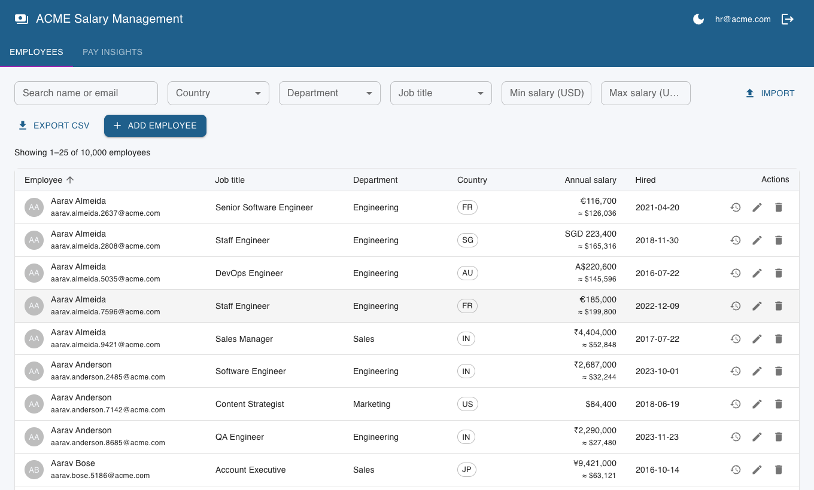

## Features
- **Sign-in** for the HR manager (JWT, passwords hashed with scrypt); every data route needs a valid token
- Employee CRUD with validation (positive salary, unique email, known country, no future hire date)
- Search, filter (country / department / job title / USD salary range), sort, server-side pagination
- Salaries stored in local currency; USD equivalent shown and used for cross-country comparison
- **Pay insights:** headcount, total payroll, average and median; min / P25 / median / P75 / max by country,
  department or job title; salary distribution
- **Salary history:** every change of pay is kept with its effective date, reason and who made it; the list and
  the insights always use the current salary
- **Import from Excel or CSV:** the file is checked first (dry run) and any bad row is reported with its row
  number and column; nothing is saved unless every row is valid
- **Audit log** of who created, changed or deleted what, and of imports
- CSV export of the current filtered view
- Light/dark theme, loading and result-count feedback, save/delete confirmations
- Seed script generating 10,000 synthetic employees (deterministic; no real people)

| Pay insights | Salary history | Import check |
|---|---|---|
| 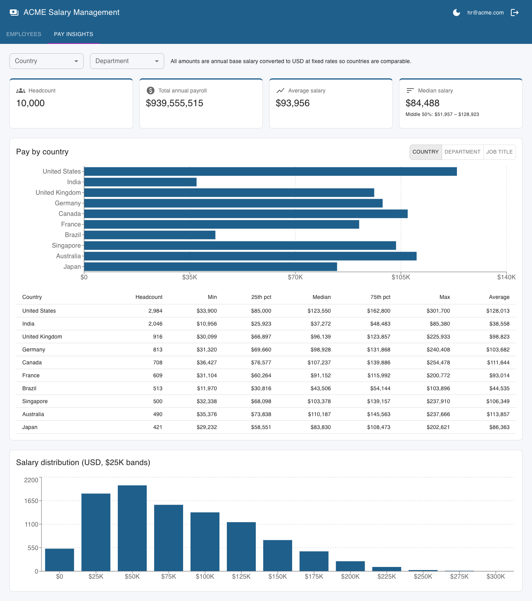 | 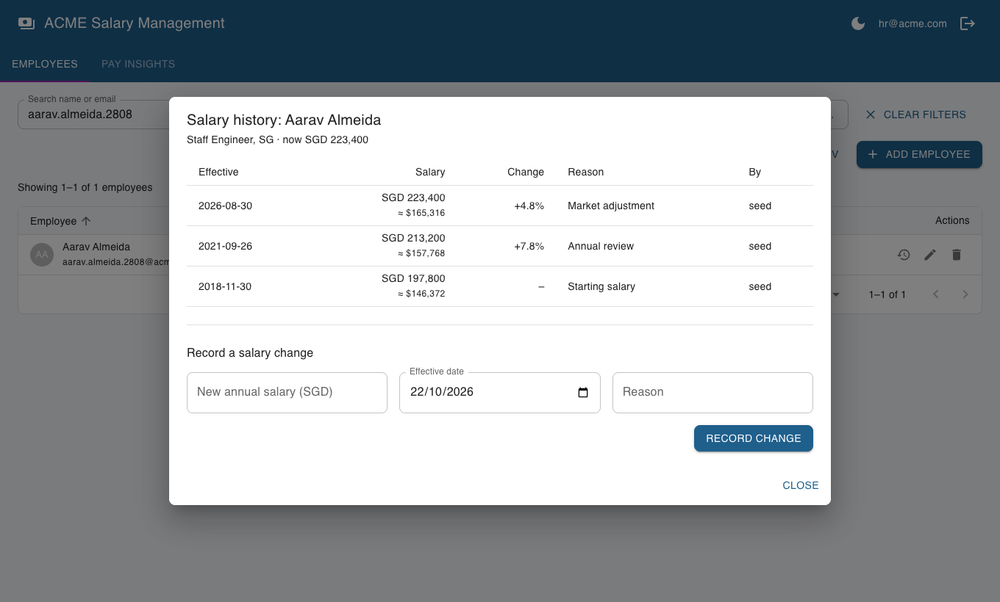 | 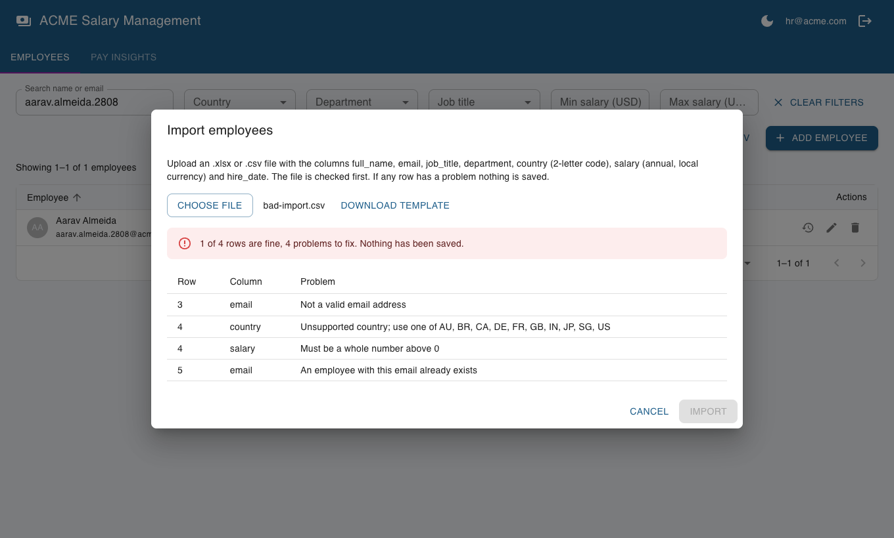 |

Also: [login page](docs/images/login.png), [dark mode](docs/images/dark.png).

## Architecture

### 1. System and deployment
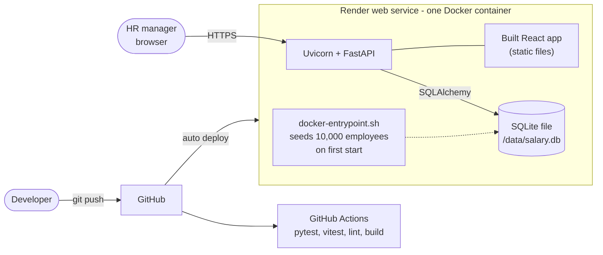
One container serves both the API (`/api/*`) and the built React files, so there is one deploy and no
CORS setup. The database is a SQLite file that is seeded the first time the container starts.

### 2. Backend layers
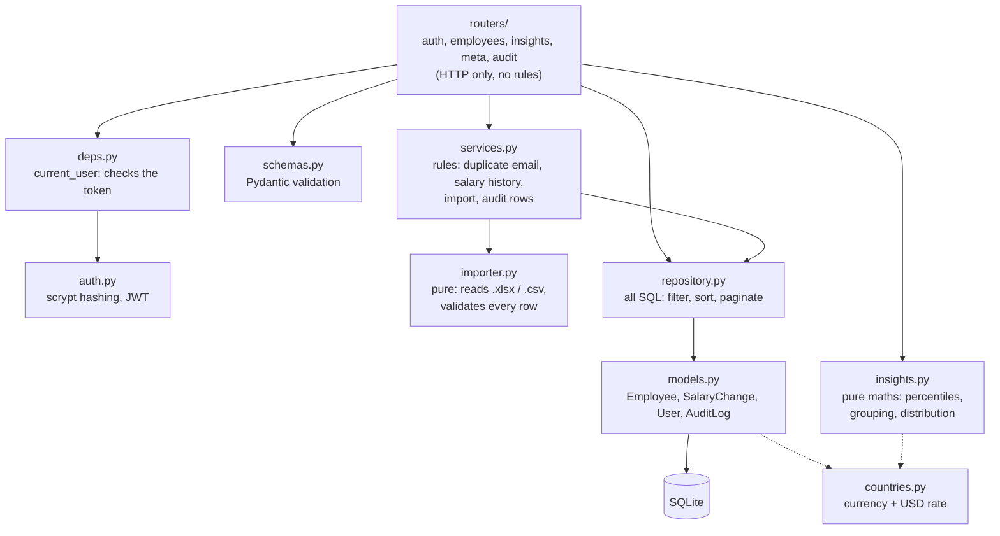
Routers only translate HTTP. Business rules live in `services.py`, SQL lives only in `repository.py`,
and the statistics (`insights.py`) and file parsing (`importer.py`) work on plain data, so they are tested
without a database.

### 3. Request flows
**List employees** (search, filter, sort, page)
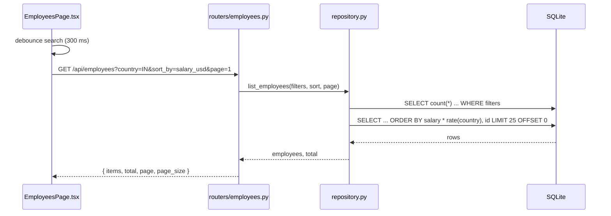
**Create an employee**
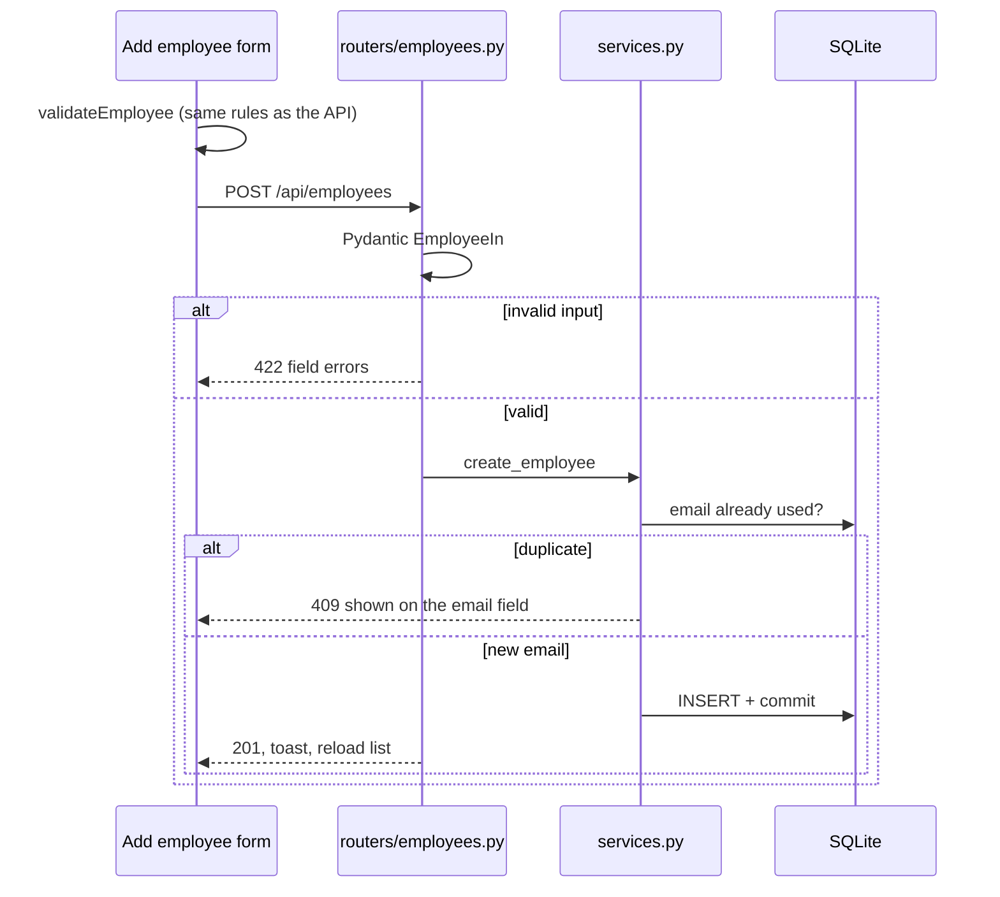
**Pay insights**
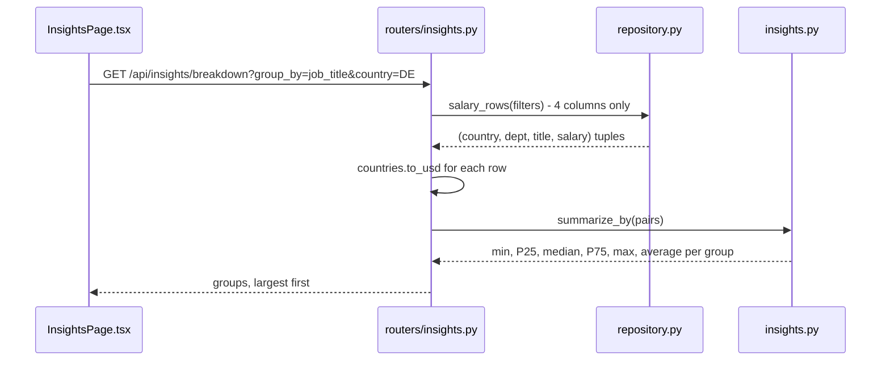

**Sign in**
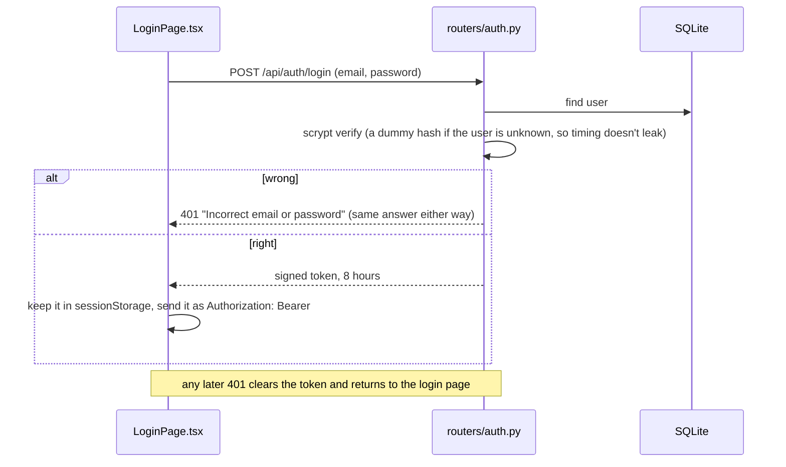
**Import a spreadsheet**
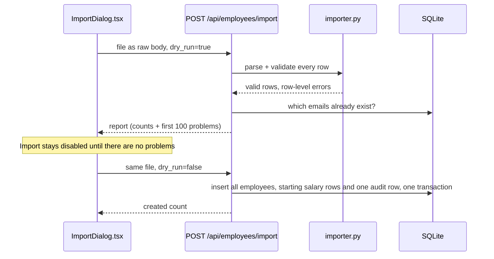

### 4. Data model
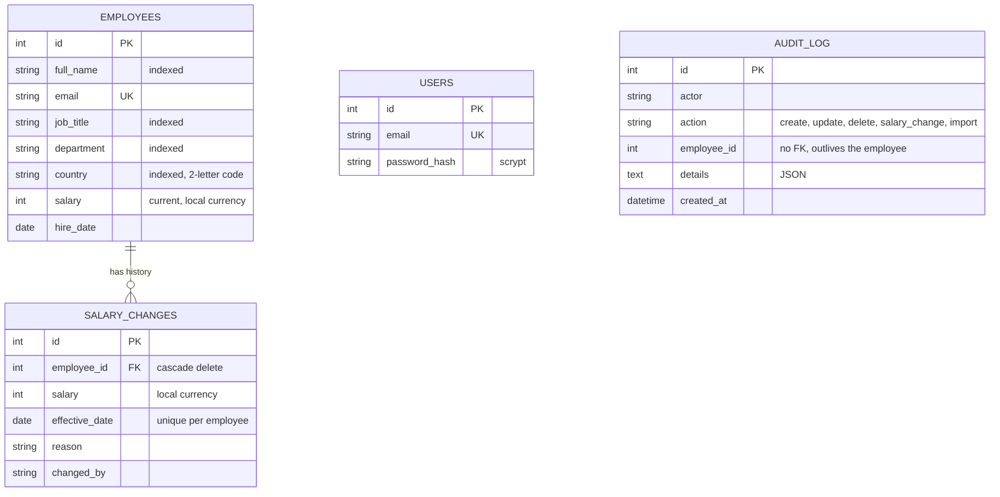
`employees.salary` is the latest row of `salary_changes`, kept on the employee so listing, sorting and the
insights never have to join. Currency and USD rate come from `country` in `countries.py`, not from the row,
so an employee's currency can never disagree with their country.

## Scalability

Today: 10,000 rows, every request answers in 10-40 ms, so the simple design is the right one.
This is how it would grow, and what would break first at each step.

| Scale | What breaks | Change |
|-------|-------------|--------|
| 10k employees, one HR user (now) | Nothing | SQLite, one container |
| 100k-500k, a few HR users | Insights load every row into Python; `OFFSET` pages get slower; free-tier restarts lose data | Postgres, `percentile_cont` in SQL, stored `salary_usd` column, keyset pagination |
| Millions, many users, audit needs | One process, slow export and import, one shared login | Several stateless API instances, Redis cache for insights, background jobs for export/import, SSO with roles in place of the single local login, read replica |

### Target architecture
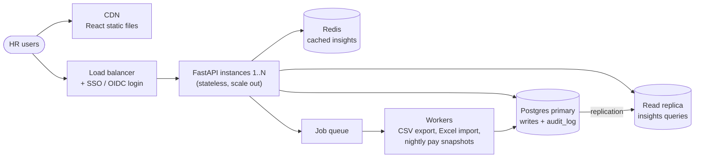
Already in place for this path: login and an audit log (a local JWT login today, SSO later), and an import
that runs in one request (a worker queue later). Design choices that make the rest cheap: the API is stateless, SQL is in one file
(`repository.py`), and the statistics are pure functions, so moving the maths into SQL or a cache
changes one layer.

## Run locally
Requires Python 3.12 and Node 20+.

```bash
make setup       # venv + npm ci
make seed        # creates backend/salary.db with 10,000 employees (~0.5 s)
make api         # http://localhost:8000   (API docs at /docs). Sign in: hr@acme.com / Acme-HR-Demo-2026
make web         # http://localhost:5173   (proxies /api to :8000)
```

Single-process, production-style: `make build`, then
`cd backend && SALARY_HR_EMAIL=hr@acme.com SALARY_HR_PASSWORD=... SALARY_JWT_SECRET=<32+ random chars> SALARY_STATIC_DIR=../frontend/dist .venv/bin/uvicorn app.main:create_app --factory`.

Settings (environment variables): `SALARY_DB_URL` (default `sqlite:///./salary.db`), `SALARY_JWT_SECRET`
(32+ characters; a random one is used if unset, so logins end when the process restarts), `SALARY_HR_EMAIL` and
`SALARY_HR_PASSWORD` (the account to sign in with; no one can sign in if they are unset).

## Tests
```bash
make test        # backend (pytest, 174 tests, ~2 s) + frontend (vitest, 74 tests)
make coverage    # the same with coverage reports
```
Coverage: backend 96% of statements (CI fails under 85%), frontend 87% (CI fails under 80%). The tests use
an in-memory database, seeded random data and fixed dates, so they give the same result every run.

## Deploy
`Dockerfile` builds the UI and bundles it with the API into one image; the entrypoint seeds the database
on first start. `render.yaml` is a ready Render blueprint: Render generates the signing secret itself, and the demo
login is set there.
```bash
docker build -t salary-management .
docker run -p 8000:8000 \
  -e SALARY_HR_EMAIL=hr@acme.com -e SALARY_HR_PASSWORD=Acme-HR-Demo-2026 \
  -e SALARY_JWT_SECRET=$(python3 -c "import secrets;print(secrets.token_urlsafe(32))") \
  salary-management
```

## API (summary)
Everything except `/api/health` and `/api/auth/login` needs `Authorization: Bearer <token>`.

| Method | Path | Notes |
|--------|------|-------|
| POST | `/api/auth/login` | `{email, password}` returns a token; 401 for any wrong combination |
| GET | `/api/auth/me` | who the token belongs to |
| GET | `/api/employees` | `search, country, department, job_title, min_salary_usd, max_salary_usd, sort_by, order, page, page_size` |
| POST / PUT / DELETE | `/api/employees[/{id}]` | 201 / 200 / 204; 409 on duplicate email; 422 on invalid input |
| GET | `/api/employees/export.csv` | same filters; streamed |
| GET | `/api/employees/{id}/salary-history` | every change, oldest first, with % change |
| POST | `/api/employees/{id}/salary-changes` | `{salary, effective_date, reason}`; 422 before the hire date or in the future, 409 if that day already has one |
| POST | `/api/employees/import?filename=&dry_run=` | the .xlsx or .csv as the raw request body (max 5 MB, 20,000 rows); returns a row-level report |
| GET | `/api/employees/import-template.csv` | a file with the right columns |
| GET | `/api/insights/summary` \| `/breakdown?group_by=country\|department\|job_title` \| `/distribution?bucket_size=` | same filters as the list |
| GET | `/api/meta` | countries (with currency) and distinct departments / job titles |
| GET | `/api/audit?employee_id=&limit=` | newest first |

## Known limitations
- One role: whoever has the login can do everything. There is no password reset, no lock-out after failed
  attempts, and the token lives in `sessionStorage` (a script injected into the page could read it). The
  next step would be SSO with roles.
- Exchange rates are fixed (see [requirements](docs/01-requirements.md)).
- The free Render disk is not persistent: the deployed site goes back to the seeded data when it restarts.
- Importing 20,000 rows takes a few seconds inside one request (measured: about 5 s); a bigger file should go
  through a background job.
- All data is synthetic.
