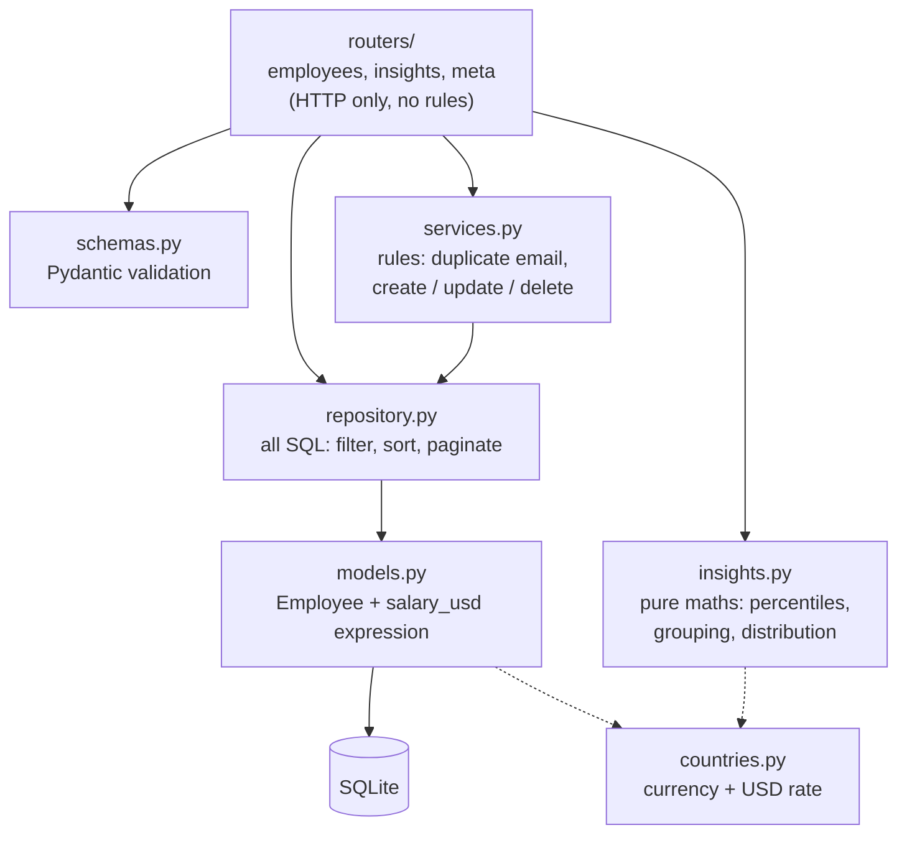
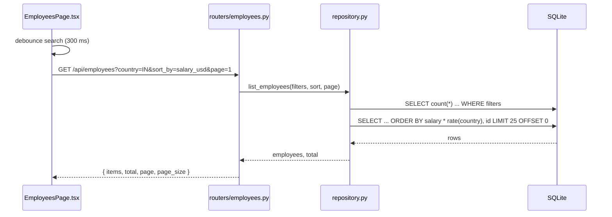
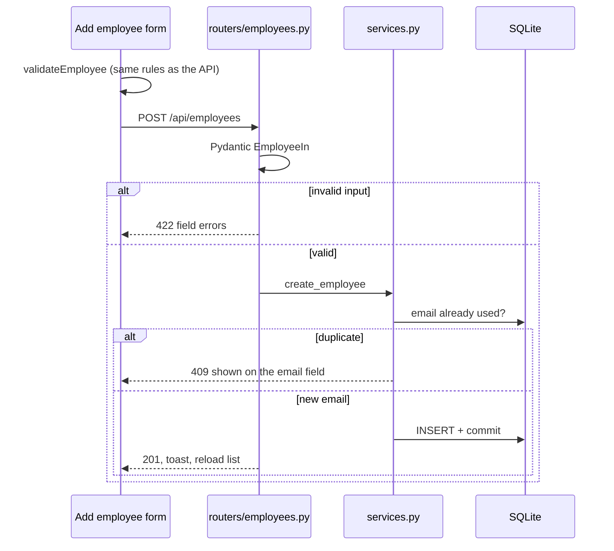
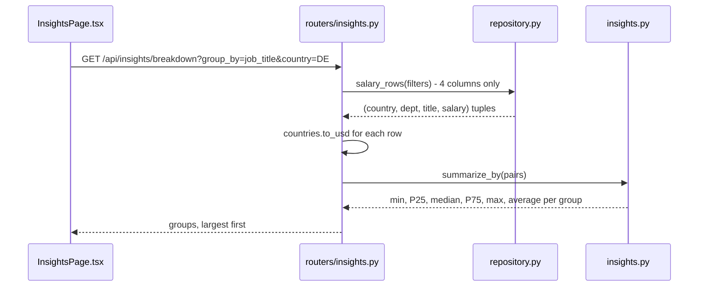
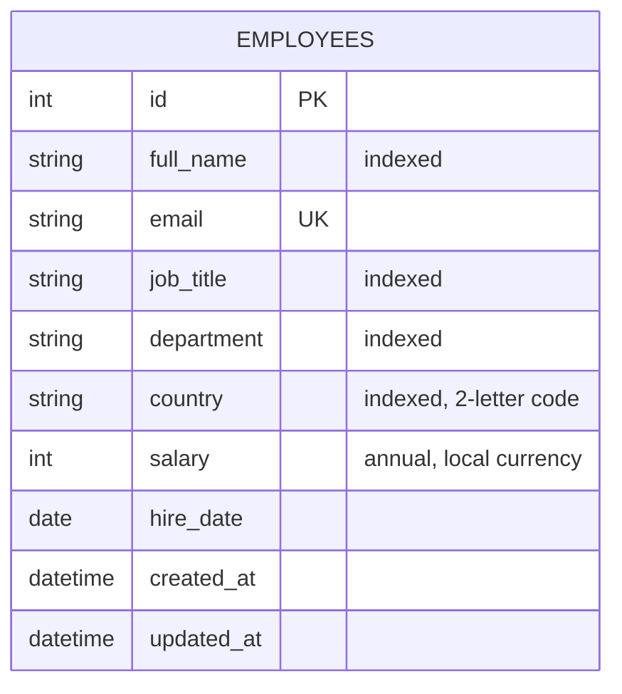

# ACME Salary Management

Web app for an HR Manager to manage salaries for ~10,000 employees across 10 countries and to answer
"how do we pay people?". Python (FastAPI + SQLAlchemy + SQLite) backend, React + TypeScript + MUI frontend.

**Live demo:** https://salary-management-fh3n.onrender.com/ (free tier: the first load after idle can take 30-60 s)

- Requirements: [docs/01-requirements.md](docs/01-requirements.md)
- Design, trade-offs, performance: [docs/02-design-notes.md](docs/02-design-notes.md)
- AI usage: [docs/03-ai-usage.md](docs/03-ai-usage.md)

## Features
- Employee CRUD with validation (positive salary, unique email, known country, no future hire date)
- Search, filter (country / department / job title / USD salary range), sort, server-side pagination
- Salaries stored in local currency; USD equivalent shown and used for cross-country comparison
- **Pay insights:** headcount, total payroll, average and median; min / P25 / median / P75 / max by country,
  department or job title; salary distribution
- CSV export of the current filtered view
- Light/dark theme, loading and result-count feedback, save/delete confirmations
- Seed script generating 10,000 synthetic employees (deterministic; no real people)

## Architecture

### 1. System and deployment

One container serves both the API (`/api/*`) and the built React files, so there is one deploy and no
CORS setup. The database is a SQLite file that is seeded the first time the container starts.

### 2. Backend layers

Routers only translate HTTP. Business rules live in `services.py`, SQL lives only in `repository.py`,
and the statistics in `insights.py` work on plain lists, so they are tested without a database.

### 3. Request flows
**List employees** (search, filter, sort, page)

**Create an employee**

**Pay insights**


### 4. Data model

Currency and USD rate are derived from `country` in `countries.py`, not stored per row, so an
employee's currency can never disagree with their country.

## Scalability

Today: 10,000 rows, every request answers in 10-40 ms, so the simple design is the right one.
This is how it would grow, and what would break first at each step.

| Scale | What breaks | Change |
|-------|-------------|--------|
| 10k employees, one HR user (now) | Nothing | SQLite, one container |
| 100k-500k, a few HR users | Insights load every row into Python; `OFFSET` pages get slower; free-tier restarts lose data | Postgres, `percentile_cont` in SQL, stored `salary_usd` column, keyset pagination |
| Millions, many users, audit needs | One process, slow CSV export, no access control | Several stateless API instances, Redis cache for insights, background jobs for export/import, SSO login + audit log, read replica |

### Target architecture

Design choices that make this path cheap: the API is stateless, SQL is in one file
(`repository.py`), and the statistics are pure functions, so moving the maths into SQL or a cache
changes one layer.

## Run locally
Requires Python 3.12 and Node 20+.

```bash
make setup       # venv + npm ci
make seed        # creates backend/salary.db with 10,000 employees (~0.5 s)
make api         # http://localhost:8000   (API docs at /docs)
make web         # http://localhost:5173   (proxies /api to :8000)
```

Single-process, production-style: `make build`, then
`cd backend && SALARY_STATIC_DIR=../frontend/dist .venv/bin/uvicorn app.main:create_app --factory`.

## Tests
```bash
make test        # backend (pytest, 69 tests, ~1 s) + frontend (vitest, 25 tests)
```

## Deploy
`Dockerfile` builds the UI and bundles it with the API into one image; the entrypoint seeds the database
on first start. `render.yaml` is a ready Render blueprint.
```bash
docker build -t salary-management . && docker run -p 8000:8000 salary-management
```

## API (summary)
| Method | Path | Notes |
|--------|------|-------|
| GET | `/api/employees` | `search, country, department, job_title, min_salary_usd, max_salary_usd, sort_by, order, page, page_size` |
| POST / PUT / DELETE | `/api/employees[/{id}]` | 201 / 200 / 204; 409 on duplicate email; 422 on invalid input |
| GET | `/api/employees/export.csv` | same filters; streamed |
| GET | `/api/insights/summary` \| `/breakdown?group_by=country\|department\|job_title` \| `/distribution?bucket_size=` | same filters |
| GET | `/api/meta` | countries (with currency) and distinct departments / job titles |

## Known limitations
No authentication (single persona, see requirements); static FX rates; one current salary per employee
(no history). All data is synthetic.
