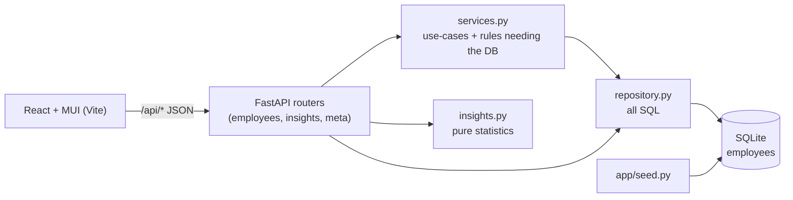

# Design notes & trade-offs

## Architecture

| Layer | Responsibility | Why separate |
|-------|----------------|--------------|
| `routers/` | HTTP shape: params, status codes | Thin; no business rules |
| `schemas.py` | Input validation (Pydantic) | One definition of "valid employee" |
| `services.py` | Duplicate-email rule, create/update/delete | Testable rules, domain errors -> HTTP in one handler |
| `repository.py` | Filtering, sorting, pagination SQL | Filters are shared by list, export and insights |
| `insights.py` | Percentiles, grouping, histogram | Pure functions: unit-tested without a DB |
| `seed.py` | Deterministic data generation | Same seed => same data; tests rely on that |

## Key decisions

1. **Money as integers in local currency.** No float drift; the currency is derived from the country so
   it can never disagree with it. USD is a *derived view* (static rates in `countries.py`).
2. **USD normalisation happens in SQL for sort/filter** (a `CASE` on country in `models.py`) so "sort by
   salary" and "min salary" are meaningful across countries. Sorting raw local amounts would put 3M INR
   (~$36K) above 100K GBP (~$127K).
3. **Insights are computed in Python from a narrow 4-column select**, not SQL aggregates. SQLite has no
   median/percentile, and the dataset is 10k rows; doing it in Python keeps the logic simple and unit
   testable. See "Scaling" below for when this stops being right.
4. **Median and quartiles, not just average.** HR questions are about "typical" pay; averages are skewed
   by a few executives.
5. **Server-side pagination, filtering and sorting.** 10k rows in the browser would be slow and wasteful;
   the API caps `page_size` at 200. A stable `id` tie-breaker prevents rows repeating across pages.
6. **CSV export is streamed** and neutralises formula-leading cells (`=`, `+`, `-`, `@`) because the
   export is meant to be opened in Excel.
7. **One deployable.** FastAPI serves the built React app, so there is one container, one origin and no
   CORS configuration.
8. **App factory (`create_app(engine)`)** lets every test get a fresh in-memory database; the suite runs
   in about one second.

## Performance (10,000 rows, local, SQLite)

Measured with the FastAPI test client against the seeded database:

| Call | Time |
|------|------|
| Seed 10,000 employees (bulk insert) | ~0.4 s |
| List page (50 rows) | ~23 ms |
| List filtered + sorted by USD salary | ~10 ms |
| Name search | ~10 ms |
| Insights summary / breakdown / distribution | 26-41 ms |

Indexes exist on country, department, job title and name. The name search uses `LIKE '%x%'`, which
cannot use an index; at 10k rows it is a trivial scan.

## Scaling: what I would change first
- **Auth + audit log** (salary data is sensitive): not built, see requirements.
- **>~500k rows:** move to Postgres, compute percentiles with `percentile_cont`, add a `salary_usd`
  column (or materialised view) maintained on write, and use keyset pagination instead of `OFFSET`.
- **Live FX / historical rates:** store the rate used per snapshot so past reports are reproducible.
- **Pay history:** an effective-dated `salary_changes` table instead of a single `salary` column.

## Testing approach
- **Backend (69 tests):** API tests through `TestClient` with an in-memory DB, written as behaviour
  ("salary range filter compares in USD, not local currency"); pure-function tests for statistics and
  seed determinism; a security test for path traversal in static serving and CSV formula injection.
- **Frontend (25 tests):** Vitest + Testing Library with the API layer mocked: validation rules, API
  error mapping, and the main user flows (sort, delete confirmation, form validation, empty/error states).
- Deterministic: seeded RNG, fixed dates passed in, no network, no sleeps.
